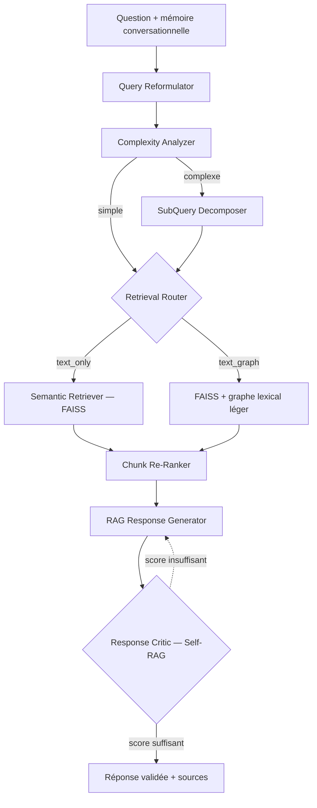

# 🧠 PsyBot — Chatbot RAG spécialisé sur l'anxiété et les TCC

PsyBot est un chatbot médical en français centré sur l'anxiété, le **Trouble d'Anxiété
Généralisée (TAG)** et les **Thérapies Cognitivo-Comportementales (TCC)**. Ses réponses
s'appuient sur un corpus documentaire spécialisé grâce à la **Retrieval-Augmented Generation (RAG)**.

Le projet suit une progression en trois architectures, chacune évaluée par rapport à la précédente :

**Sans RAG** → **RAG simple (Naive RAG)** → **Agentic RAG**

Projet de Fin d'Année (PFA) — ENET'Com Sfax.

> ⚠️ PsyBot est un prototype académique. Il ne remplace pas un avis médical ou psychologique
> professionnel. En cas de crise, contactez les services d'urgence.

## 📊 Résultats

Évaluation sur 5 questions communes avec la métrique [RAGAS](https://docs.ragas.io)
`answer_relevancy` :

| Architecture | Score RAGAS moyen | Gain vs Sans RAG | Latence estimée |
|---|---|---|---|
| Sans RAG | 0.425 | — | ≈ 2.8 s |
| RAG simple | 0.618 | +45 % | 6–7 s |
| **Agentic RAG** | **0.790** | **+86 %** | 8–15 s |

Chaque couche ajoutée (retrieval, puis pilotage par agents, puis critique) améliore la pertinence
des réponses, au prix d'une latence plus élevée mais acceptable. Le RAG apporte en plus la
**traçabilité** : chaque réponse est accompagnée de ses sources.

Analyse qualitative détaillée : [docs/rapport_comparaison_rag_simple.md](docs/rapport_comparaison_rag_simple.md)

## 🏗️ Les trois architectures

### 1. Sans RAG
La question est envoyée directement au LLM (Llama 3.1 8B). Les réponses sont fluides mais
génériques, avec des chiffres approximatifs et aucune source : c'est la base de comparaison.

### 2. RAG simple
```
Question → Embedding → Recherche FAISS (top-k) → Contexte + LLM → Réponse avec sources
```
Les réponses sont ancrées dans le corpus, mais restent sensibles à la formulation de la question
et ne sont pas vérifiées avant affichage.

### 3. Agentic RAG
Huit agents spécialisés ajoutent du pilotage avant le retrieval et un contrôle qualité après la
génération :



- **Mémoire conversationnelle** : la question courante est enrichie par les échanges récents,
  ce qui résout les références implicites (« Et pour l'anxiété ? »).
- **Routage `text_graph`** : pour les questions relationnelles, un retriever graphe léger
  (co-occurrence de termes entre chunks) complète la recherche sémantique, sans base graphe dédiée.
- **Critique Self-RAG** : la réponse est notée sur 10 selon cinq critères (consistance avec les
  sources, clarté, exactitude, pertinence, sécurité) avant d'être acceptée ou régénérée.

Documentation détaillée : [docs/architecture_agentic_finale.md](docs/architecture_agentic_finale.md)

## 🧰 Stack technique

| Étape | Modèle / outil |
|---|---|
| Reformulation, complexité, décomposition, routage | Llama 3.1 8B Instant (Groq) |
| Embeddings | `paraphrase-multilingual-MiniLM-L12-v2` (local, 384 dimensions) |
| Index vectoriel | FAISS, similarité cosinus |
| Génération | Llama 3.3 70B Versatile (Groq) |
| Critique Self-RAG | Llama 3.1 8B Instant (Groq) |
| Orchestration | LangChain (fournisseurs interchangeables : Groq, Gemini, OpenAI) |
| Interface | Gradio |

Les embeddings et la recherche tournent en local ; seule la génération passe par une API. Une
exécution 100 % locale avec Ollama a été testée, mais elle était trop lente sur le matériel
disponible : Groq a été retenu pour le prototype.

### Corpus

- PDFs sur l'anxiété, le TAG, la TCC et les protocoles associés (extraction du texte, OCR si besoin, nettoyage)
- Découpage récursif : chunks de **500 caractères**, chevauchement de **50**
- **2 185 chunks** (moyenne 462 caractères, 87 % entre 350 et 650)

## 🛠️ Installation

Prérequis : Python 3.11+ et une clé API gratuite [Groq](https://console.groq.com/keys)
(ou [Google AI Studio](https://aistudio.google.com/apikey)).

```bash
git clone https://github.com/YessineBouattour/Psybot.git
cd Psybot

python -m venv .venv
.venv\Scripts\activate          # Windows
# source .venv/bin/activate     # Linux / macOS

pip install -r requirements.txt
pip install -r requirements_agentic.txt

cp .env.example .env            # puis renseigner GROQ_API_KEY dans .env
```

Guide détaillé : [INSTALLATION.md](INSTALLATION.md) · Démarrage rapide : [QUICKSTART.md](QUICKSTART.md)

## 🚀 Utilisation

```bash
python test_groq.py                  # vérifier la clé API
python chatbot_agentic_rag_ui.py     # puis ouvrir http://localhost:7867
```

| Chatbot | Commande | Port |
|---|---|---|
| Sans RAG | `python chatbot_sans_rag_ui.py` | 7862 |
| RAG simple | `python chatbot_avec_rag_simple.py` | 7865 |
| RAG (version intermédiaire) | `python chatbot_avec_rag.py` | 7866 |
| **Agentic RAG** | `python chatbot_agentic_rag_ui.py` | 7867 |

L'index FAISS pré-calculé est fourni dans `data/vector_store/`. Pour le reconstruire à partir de
`data/paragraphs.json` :

```bash
python run_phase1.py
```

## 📦 Structure du projet

```
├── chatbot_*.py              # Interfaces Gradio des trois architectures
├── run_phase1.py             # Chunking + embeddings + construction de l'index
├── test_groq.py              # Test de connexion à l'API Groq
├── src/
│   ├── data_processing/      # chunker, embedder, pipeline
│   ├── retrieval/            # index FAISS, retriever, graphe lexical
│   ├── agents/               # pré-retrieval, re-ranking, pipeline agentique
│   └── generation/           # générateur et critique Self-RAG
├── scripts/                  # utilitaires (extraction PDF FR, passage multilingue)
├── data/
│   ├── paragraphs*.json      # corpus extrait des PDFs
│   ├── processed/            # chunks + embeddings
│   └── vector_store/         # index FAISS
├── comparaisons_chatbot/     # conversations sauvegardées pour la comparaison
└── docs/                     # documentation technique et analyses
```

Les PDFs sources (`data/stress_anxiety_pdfs/`) ne sont pas versionnés pour des raisons de taille
et de droits d'auteur.

## 📄 Licence

Projet à usage académique.
